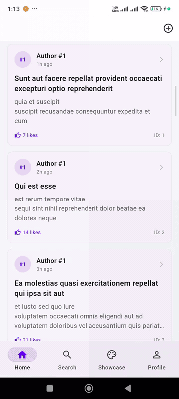
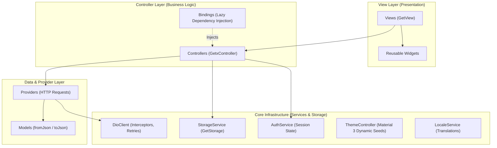
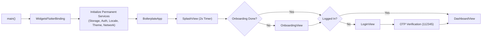
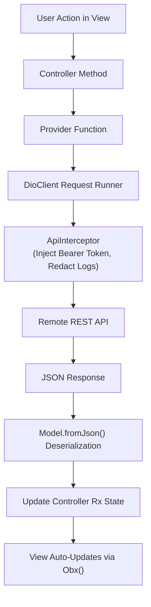
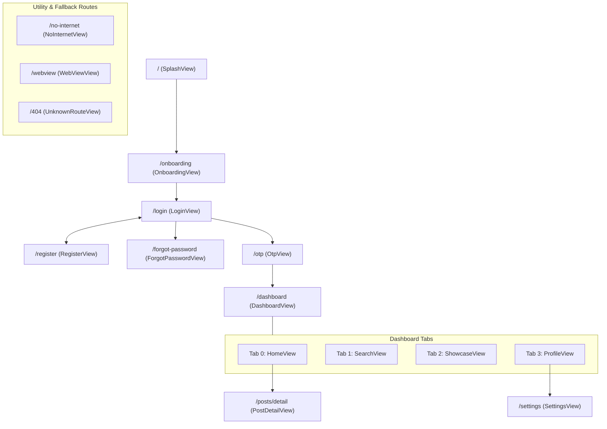

<div align="center">

# Flutter GetX MVC Boilerplate

**A clean, production-ready starter template for Flutter applications built with GetX (MVC+S).**

Clone it, install dependencies, and start building your product in three commands.

[-02569B?style=for-the-badge&logo=flutter&logoColor=white)](https://flutter.dev)
[](https://dart.dev)
[](https://pub.dev/packages/get)
[](https://github.com/SheikhAman/flutter-getx-mvc-boilerplate)
[](https://github.com/SheikhAman/flutter-getx-mvc-boilerplate)
[](LICENSE)

[Quick Start](#-quick-start) &bull; [Live Demos](#-live-app-demos) &bull; [Architecture](#-architecture-overview) &bull; [App Flows](#-app-flows) &bull; [How to Add a Module](#-how-to-add-a-new-module) &bull; [How to Rename](#-how-to-rename-this-for-your-own-app) &bull; [Testing](#-testing--quality-gates) &bull; [FAQ](#-troubleshooting--faq)

</div>

---

## 🎯 Who Is This For?

This boilerplate is designed for developers who want to start a new Flutter project without spending days setting up architecture, routing, storage, theming, and API clients.

- **Beginner-Friendly:** Clear folder structure and readable files with helpful comments.
- **Modular MVC+S:** Uses Model-View-Controller-Service. There are no complicated use cases or abstract repository interfaces.
- **Batteries Included:** Authentication flow, infinite scroll feed, post creation, profile editing, dynamic dark mode, and multi-language support.
- **Android-Tested:** Developed and verified on Android devices and emulators. Standard Flutter tooling builds for iOS and web, but ongoing testing is conducted on Android.

---

## ⚡ Quick Start

Run these three commands in your terminal to get the app running:

```bash
# 1. Clone the repository
git clone https://github.com/SheikhAman/flutter-getx-mvc-boilerplate.git
cd flutter-getx-mvc-boilerplate

# 2. Get dependencies
flutter pub get

# 3. Run on your connected device or emulator
flutter run
```

That is all. The app boots through the splash screen directly into onboarding.

---

## 📱 Live App Demos

<div align="center">

| Reactive Post Creation & Feed Ingestion | REST Feed, Shimmer & Infinite Scroll |
| :---: | :---: |
| <picture><source srcset="screenshots/create_post_flow.webp" type="image/webp"></picture> | <picture><source srcset="screenshots/feed_pagination_flow.webp" type="image/webp"></picture> |
| **Modal Sheet &bull; Double-Submit Guard**<br><sub>Tap <code>+</code> &rarr; enter title & content &rarr; submit &rarr; sheet closes &rarr; feed updates instantly</sub> | **REST Feed &bull; Shimmer &bull; Infinite Scroll**<br><sub>Splash transition &rarr; shimmer skeleton loader &rarr; scroll to fetch page 2</sub> |

</div>

---

## 🏛 Architecture Overview

This project uses the **Modular GetX MVC+S** pattern:



### Layer Responsibilities

1. **Views (`GetView<T>`):** Pure UI widgets. They display state and listen to reactive variables with `Obx`. Views never call HTTP endpoints directly.
2. **Controllers (`GetxController`):** Manage state and user actions. They use reactive variables (`RxBool`, `RxList`, `RxString`) and call Providers for network data.
3. **Providers:** Feature-specific classes that make HTTP calls through the singleton `DioClient`.
4. **Permanent Services (`GetxService`):** Global singletons (`AuthService`, `StorageService`, `ThemeController`, `LocaleService`, `NetworkInfo`) initialized at app start and preserved across routes.
5. **Bindings (`Bindings`):** Wire controllers and providers lazily when a route is accessed using `Get.lazyPut()`.

---

## 🔄 App Flows

### 1. App Bootstrap Flow



### 2. HTTP Request Flow



### 3. Authentication & Auto-Logout (401) Flow

```mermaid
flowchart TD
    subgraph LoginFlow ["Login & Verification"]
        L1["User submits email & password"] --> L2["Navigate to OTP Screen"]
        L2 --> L3["Enter Demo OTP: 112345"]
        L3 --> L4["Save Token in StorageService"]
        L4 --> L5["AuthService sets isLoggedIn = true"]
        L5 --> L6["Navigate to /dashboard"]
    end

    subgraph AutoLogout ["401 Session Expiry"]
        E1["API returns 401 Unauthorized"] --> E2["ApiInterceptor catches 401"]
        E2 --> E3["Call AuthService.logout()"]
        E3 --> E4["Clear Token & Local Storage"]
        E4 --> E5["Route to /login with notification"]
    end
```



### 4. Navigation Map



---

## 📂 Project Structure

```text
lib/
├── app/
│   ├── core/
│   │   ├── network/           # ApiConstants, ApiExceptions, ApiInterceptor, DioClient, NetworkInfo
│   │   ├── routes/            # AppPages, AppRoutes, Guards (AuthGuard, OnboardingGuard)
│   │   ├── services/          # AuthService, LocaleService, StorageService, ThemeController
│   │   ├── utils/             # AppSnackbar, Formatters, Validators
│   │   ├── values/            # AppAssets, AppColors, AppSizes, AppStrings, AppTextStyles
│   │   └── widgets/           # CustomAppBar, CustomButton, CustomTextField, EmptyStateView, LoadingView
│   ├── data/
│   │   └── models/            # ApiResponseModel, PostModel, UserModel
│   └── modules/
│       ├── auth/              # Bindings, Controllers, Providers, Views (Login, Register, OTP, ForgotPassword)
│       ├── common/            # NoInternetView, UnknownRouteView, WebViewView
│       ├── dashboard/         # DashboardView (Bottom navigation: Home, Search, Showcase, Profile)
│       ├── home/              # HomeView, PostCard widget, Create Post sheet, HomeProvider
│       ├── onboarding/        # OnboardingView & OnboardingPageItem widget
│       ├── post_detail/       # PostDetailView, Controller, Provider
│       ├── profile/           # ProfileView, ProfileController, Image picker avatar, ProfileProvider
│       ├── search/            # SearchView, SearchController (400ms debounce), SearchProvider
│       ├── settings/          # SettingsView, SettingsController (Theme, Palette Seeds, Locale)
│       ├── showcase/          # ShowcaseView, ShowcaseController, Design system catalog
│       └── splash/            # SplashView, SplashController (Route transition logic)
└── main.dart                  # ScreenUtilInit + EasyLoading + GetMaterialApp entrypoint
```

---

## 🛠 Tech Stack & Dependencies

All dependencies are pinned and verified:

| Package | Version | Purpose |
| :--- | :--- | :--- |
| **Flutter SDK** | `>=3.3.0 <4.0.0` (Tested on `3.41.9`) | Framework runtime |
| **Dart SDK** | `3.11.5` | Programming language |
| **[get](https://pub.dev/packages/get)** | `^4.7.3` | State management, routing, and dependency injection |
| **[dio](https://pub.dev/packages/dio)** | `^5.9.2` | HTTP client with token interceptor and retry control |
| **[get_storage](https://pub.dev/packages/get_storage)** | `^2.1.1` | Lightweight persistent key-value storage |
| **[flutter_screenutil](https://pub.dev/packages/flutter_screenutil)** | `^5.9.3` | Responsive scaling across screen sizes |
| **[connectivity_plus](https://pub.dev/packages/connectivity_plus)** | `^7.1.1` | Network connectivity detection |
| **[flutter_easyloading](https://pub.dev/packages/flutter_easyloading)** | `^3.0.5` | Global loading overlay HUD |
| **[webview_flutter](https://pub.dev/packages/webview_flutter)** | `^4.13.0` | In-app web browser |
| **[intl](https://pub.dev/packages/intl)** | `^0.20.2` | Date formatting and localization support |
| **[pin_code_fields](https://pub.dev/packages/pin_code_fields)** | `^8.0.1` | 6-digit OTP code input widget |
| **[image_picker](https://pub.dev/packages/image_picker)** | `^1.1.2` | Profile photo selection from camera or gallery |
| **[shimmer](https://pub.dev/packages/shimmer)** | `^3.0.0` | Skeleton loading effects for feed lists |

---

## 🔐 Auth & Demo Credentials

The authentication module is a complete, self-contained mock implementation. It allows you to test navigation, session persistence, and UI validation without setting up a backend server.

1. Open the app and tap **Get Started** on the Onboarding screen.
2. At the **Login** screen, enter any valid email (e.g. `alex@example.com`) and password.
3. Tap **Sign In**. The app navigates to the **OTP Verification** screen.
4. Enter the public demo OTP:
   ```text
   112345
   ```
5. Verification completes, stores the user session in `GetStorage`, and takes you to the **Dashboard**.

---

## 🧩 How to Add a New Module

Adding a new feature module takes four simple steps:

### 1. Create the Provider
Create `lib/app/modules/<feature>/providers/<feature>_provider.dart`:
```dart
import '../../../core/network/dio_client.dart';

class FeatureProvider {
  final DioClient _dioClient;

  FeatureProvider({DioClient? dioClient}) : _dioClient = dioClient ?? DioClient();

  Future<dynamic> fetchData() async {
    return await _dioClient.get('/posts');
  }
}
```

### 2. Create the Controller
Create `lib/app/modules/<feature>/controllers/<feature>_controller.dart`:
```dart
import 'package:get/get.dart';
import '../providers/feature_provider.dart';

class FeatureController extends GetxController {
  final FeatureProvider provider;

  FeatureController({FeatureProvider? featureProvider})
      : provider = featureProvider ?? FeatureProvider();

  final RxBool isLoading = false.obs;
  final RxList<dynamic> items = <dynamic>[].obs;

  @override
  void onInit() {
    super.onInit();
    loadItems();
  }

  Future<void> loadItems() async {
    isLoading.value = true;
    try {
      final data = await provider.fetchData();
      if (data is List) items.assignAll(data);
    } catch (_) {
      // Error handling
    } finally {
      isLoading.value = false;
    }
  }
}
```

### 3. Create the Binding
Create `lib/app/modules/<feature>/bindings/<feature>_binding.dart`:
```dart
import 'package:get/get.dart';
import '../controllers/feature_controller.dart';
import '../providers/feature_provider.dart';

class FeatureBinding extends Bindings {
  @override
  void dependencies() {
    Get.lazyPut<FeatureProvider>(() => FeatureProvider());
    Get.lazyPut<FeatureController>(() => FeatureController(featureProvider: Get.find()));
  }
}
```

### 4. Create the View & Register Route
Create `lib/app/modules/<feature>/views/<feature>_view.dart`:
```dart
import 'package:flutter/material.dart';
import 'package:get/get.dart';
import '../controllers/feature_controller.dart';

class FeatureView extends GetView<FeatureController> {
  const FeatureView({super.key});

  @override
  Widget build(BuildContext context) {
    return Scaffold(
      appBar: AppBar(title: const Text('My Feature')),
      body: Obx(() {
        if (controller.isLoading.value) {
          return const Center(child: CircularProgressIndicator());
        }
        return ListView.builder(
          itemCount: controller.items.length,
          itemBuilder: (context, index) => ListTile(
            title: Text('Item $index'),
          ),
        );
      }),
    );
  }
}
```

Register your new route in:
1. `lib/app/core/routes/app_routes.dart`:
   ```dart
   static const String feature = '/feature';
   ```
2. `lib/app/core/routes/app_pages.dart`:
   ```dart
   GetPage(
     name: AppRoutes.feature,
     page: () => const FeatureView(),
     binding: FeatureBinding(),
   ),
   ```

---

## 🏷 How to Rename This for Your Own App

When you clone this template for your own commercial or personal project, update the following identifiers:

### 1. Dart Package Name
- In [`pubspec.yaml`](pubspec.yaml), change line 1:
  ```yaml
  name: my_app_name
  ```
- Search and replace `package:flutter_getx_mvc_boilerplate/` across your project with `package:my_app_name/`.

### 2. App Display Name
- In [`lib/main.dart`](lib/main.dart), update the `GetMaterialApp` title:
  ```dart
  title: 'My App Name',
  ```
- In [`lib/app/core/values/app_strings.dart`](lib/app/core/values/app_strings.dart), update the `appName` key for English and Bengali.

### 3. Android Package Name & Application ID
- In [`android/app/build.gradle.kts`](android/app/build.gradle.kts), update `namespace` and `applicationId`:
  ```kotlin
  namespace = "com.mycompany.myapp"
  defaultConfig {
      applicationId = "com.mycompany.myapp"
  }
  ```
- In [`android/app/src/main/AndroidManifest.xml`](android/app/src/main/AndroidManifest.xml), update `android:label="My App Name"`.
- Move [`MainActivity.kt`](android/app/src/main/kotlin) to match your package directory path (`com/mycompany/myapp/MainActivity.kt`) and update the `package com.mycompany.myapp` declaration.

### 4. iOS Bundle Identifier & Display Name
- In [`ios/Runner/Info.plist`](ios/Runner/Info.plist), update `CFBundleDisplayName` to `'My App Name'` and `CFBundleName` to `'my_app_name'`.
- In [`ios/Runner.xcodeproj/project.pbxproj`](ios/Runner.xcodeproj/project.pbxproj), search for `PRODUCT_BUNDLE_IDENTIFIER` and replace `com.sheikhaman.getxMvcBoilerplate` with your own bundle ID (e.g. `com.mycompany.myapp`).

### 5. Web Title & Manifest
- In [`web/index.html`](web/index.html), update `<title>` and `apple-mobile-web-app-title`.
- In [`web/manifest.json`](web/manifest.json), update `name` and `short_name`.

### 6. Verify Everything
Run these commands to confirm your rename is clean:
```bash
flutter clean
flutter pub get
dart format --output=none --set-exit-if-changed .
flutter analyze
flutter test
```

---

## 🧪 Testing & Quality Gates

This repository enforces automated quality gates via GitHub Actions on every pull request (`.github/workflows/ci.yml`):

1. **Code Formatting:** `dart format --output=none --set-exit-if-changed .`
2. **Static Analysis:** `flutter analyze` (Zero errors, zero warnings enforced)
3. **Automated Test Suite:** 44 automated tests passing.

### Test Suite Structure

| Test Suite | File | Tests | Focus Area |
| :--- | :--- | :---: | :--- |
| **Core Primitives** | `test/widget_test.dart` | 5 | Validators, formatters, API constants, UserModel & PostModel serialization |
| **Home Controller** | `test/unit/controllers/home_controller_test.dart` | 8 | Initial fetch, pull-to-refresh, pagination, post creation, and route-pop guards |
| **Home View & Create Post** | `test/widget/home_view_test.dart` | 2 | Bottom sheet dismiss, top-of-feed insertion, and double-submit protection |
| **Login View & Showcase** | `test/widget/login_view_test.dart` | 1 | Direct navigation to Component Gallery without authentication redirect |
| **Search Controller & Provider** | `test/unit/controllers/search_controller_test.dart` | 6 | Debounced 400ms search worker, local custom posts, in-memory search |
| **Auth Controller** | `test/unit/controllers/auth_controller_test.dart` | 7 | Mock login, registration, OTP validation, countdown timer, reset flow |
| **Custom Button** | `test/widget/custom_button_test.dart` | 4 | Text rendering, tap callback, loading spinner, and icon |
| **Custom Text Field** | `test/widget/custom_text_field_test.dart` | 4 | Text entry, label/hint, password eye toggle, and prefix icon |
| **Post Card** | `test/widget/post_card_test.dart` | 2 | Layout rendering, author badge, metrics, and route navigation |
| **Profile View & Logic** | `test/widget/profile_view_test.dart` | 4 | Edit profile sheet, reactive avatar initials, photo source chooser, persistence |
| **Splash & Bootstrap** | `test/widget/splash_transition_test.dart` | 1 | Full application boot, zero white screens, Splash to Onboarding transition |

### Running Tests Locally

```bash
# Run all tests
flutter test

# Run with line coverage report
flutter test --coverage
```

---

## ❓ Troubleshooting & FAQ

Here are solutions to the most common setup and environment errors:

#### 1. "The current Dart SDK version is ..." or SDK constraint errors
**Fix:** Ensure you are using Flutter 3.41.x or newer on the stable channel. Run:
```bash
flutter channel stable
flutter upgrade
```

#### 2. `flutter pub get` fails or reports dependency version conflicts
**Fix:** Clear your local pub cache and re-fetch dependencies:
```bash
flutter clean
flutter pub cache repair
flutter pub get
```

#### 3. Android build fails with "Android license status unknown"
**Fix:** Accept Android SDK licenses via the command line:
```bash
flutter doctor --android-licenses
```
Press `y` to accept each license.

#### 4. "No connected devices found" when running `flutter run`
**Fix:** Start an Android Virtual Device (AVD) from Android Studio Device Manager, or connect a physical Android device via USB with **USB Debugging** enabled in Developer Options. Verify with:
```bash
flutter devices
```

#### 5. First build takes a long time (stuck on "Running Gradle task 'assembleDebug'...")
**Fix:** This is normal on the very first run. Gradle downloads the required Android Gradle Plugin and system components. Subsequent builds will complete in seconds.

#### 6. "Target of URI doesn't exist" warnings in IDE
**Fix:** Your editor's Dart Analysis server needs to index newly fetched packages. In VS Code or Android Studio, press `Ctrl+Shift+P` (or `Cmd+Shift+P`) and choose **Dart: Restart Analysis Server**, or run `flutter pub get`.

#### 7. Direct deep links to `/dashboard` redirect to `/login`
**Fix:** This is intended behavior. The `AuthGuard` route middleware protects authenticated routes. If the user session token is not present in `GetStorage`, `AuthGuard` automatically redirects the navigation to `/login`.

---

## 🤝 Contributing

Contributions are welcome! Please review our [Contributing Guidelines](CONTRIBUTING.md) for details on code formatting, branching strategy, and pull request conventions.

---

## 📄 License

This project is open-source and distributed under the [MIT License](LICENSE).  
Copyright &copy; 2026 Sheikh Aman.
