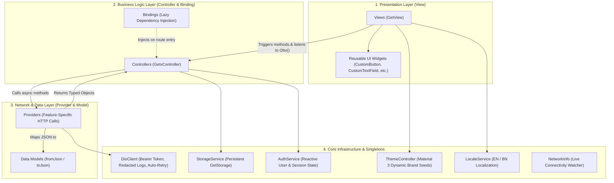
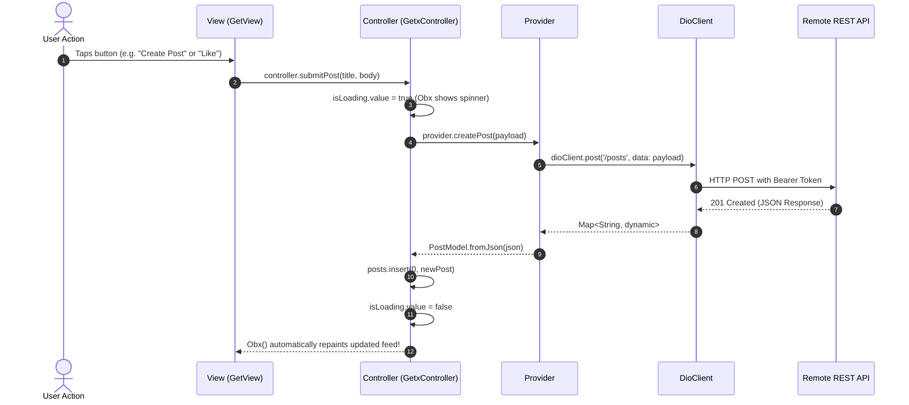
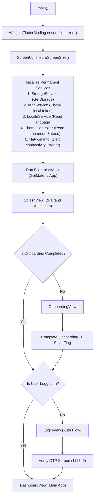
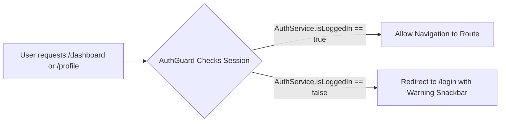
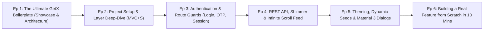

<div align="center">

# 🚀 Flutter GetX MVC Boilerplate

**A production-grade, enterprise-ready starter template for Flutter applications built with the Modular GetX (MVC+S) architecture.**

*Clone, run `flutter pub get`, and start shipping production-ready mobile apps with zero architectural boilerplate.*

[-02569B?style=for-the-badge&logo=flutter&logoColor=white)](https://flutter.dev)
[](https://dart.dev)
[](https://pub.dev/packages/get)
[](https://github.com/SheikhAman/flutter-getx-mvc-boilerplate)
[](https://github.com/SheikhAman/flutter-getx-mvc-boilerplate)
[](https://github.com/SheikhAman/flutter-getx-mvc-boilerplate)
[](LICENSE)

[Quick Start](#-quick-start) &bull; [Architecture Graph](#-architecture-overview) &bull; [App Flows](#-how-everything-works-data--app-flows) &bull; [Beginner's Guide](#-beginners-step-by-step-guide) &bull; [Add a Module](#-how-to-add-a-new-module) &bull; [Testing](#-testing--quality-gates) &bull; [Video Tutorial Roadmap](#-video-tutorial--youtube-roadmap) &bull; [FAQ](#-troubleshooting--faq)

</div>

---

## 🎯 Why This Boilerplate?

Most Flutter templates suffer from one of two extremes:
1. **Over-Engineered "Clean Architecture":** 15+ nested folders per feature (`domain/usecases`, `domain/repositories`, `data/datasources`, `data/models`, `presentation/bloc`). Beginners get lost in boilerplate before writing a single line of business logic.
2. **Spaghetti Code:** Mixing HTTP calls, state management, and UI logic directly inside `StatefulWidget` classes.

**Flutter GetX MVC Boilerplate** solves this by adopting the **Modular MVC+S (Model - View - Controller + Service)** pattern. It gives you the structure, separation of concerns, and testability of enterprise apps, with the simplicity and productivity of GetX.

### Architecture Comparison

| Feature | Over-Engineered Clean Arch | Spaghetti / Raw Flutter | 🌟 Modular GetX MVC+S (This Repo) |
| :--- | :--- | :--- | :--- |
| **Learning Curve** | High (days to understand) | Low (no structure) | **Gentle (hours to master)** |
| **Files Per Feature** | 8 - 12 files | 1 file | **3 - 4 files** (`View`, `Controller`, `Provider`, `Binding`) |
| **State Management** | Verbose events & states | Manual `setState()` | **Reactive `Rx` variables & `Obx` widgets** |
| **Dependency Injection** | Complex Service Locators | Manual constructors | **Declarative route-level `Bindings` (`Get.lazyPut`)** |
| **Testing** | Heavy mock ceremony | Hard to test UI | **Direct unit tests on Controllers & widget tests on Views** |
| **Speed to Market** | Slow | Fast initially, breaks later | **Rapid & maintainable from Day 1** |

---

## ⚡ Quick Start

Get the boilerplate running locally in 3 commands:

```bash
# 1. Clone the repository
git clone https://github.com/SheikhAman/flutter-getx-mvc-boilerplate.git
cd flutter-getx-mvc-boilerplate

# 2. Install dependencies
flutter pub get

# 3. Launch on your connected emulator or physical device
flutter run
```

### 🔐 Out-of-the-Box Demo Credentials

The authentication flow is pre-wired with a mock backend so you can test navigation, validation, and session persistence immediately:

| Credential | Value | Notes |
| :--- | :--- | :--- |
| **Email** | `user@example.com` (or any valid email) | Pre-validated format |
| **Password** | `password123` (min 6 characters) | Toggleable password visibility |
| **Demo OTP** | `112345` | Auto-fill banner supported with 1 tap |

---

## 📱 Live App Demos

<div align="center">

| Reactive Post Creation & Feed Ingestion | REST Feed, Shimmer & Infinite Scroll |
| :---: | :---: |
| <picture><source srcset="screenshots/create_post_flow.webp" type="image/webp"></picture> | <picture><source srcset="screenshots/feed_pagination_flow.webp" type="image/webp"></picture> |
| **Modal Sheet &bull; Double-Submit Guard**<br><sub>Tap <code>+</code> &rarr; enter title & content &rarr; submit &rarr; sheet closes &rarr; feed updates instantly</sub> | **REST Feed &bull; Shimmer &bull; Infinite Scroll**<br><sub>Splash transition &rarr; shimmer skeleton loader &rarr; scroll to fetch page 2</sub> |

</div>

---

## 🏛 Architecture Overview

### Full Project Graph (Mermaid)



---

## 🔄 How Everything Works (Data & App Flows)

### 1. The Reactive UI Data Flow (View 🔁 Controller)

Understanding how data moves through this boilerplate is the most important concept for beginners:



---

### 2. App Lifecycle & Bootstrapping Sequence



---

### 3. Routing & Middleware Guards

Routes in this boilerplate are protected against unauthorized access using GetX `RouteMiddleware`:



---

## 📂 Project Directory Structure

```text
lib/
├── app/
│   ├── core/                      # Global infrastructure & shared modules
│   │   ├── network/               # ApiConstants, ApiExceptions, ApiInterceptor, DioClient, NetworkInfo
│   │   ├── routes/                # AppPages, AppRoutes, Guards (AuthGuard, OnboardingGuard)
│   │   ├── services/              # Permanent singletons: AuthService, LocaleService, StorageService, ThemeController
│   │   ├── utils/                 # AppDialog, AppSnackbar, Formatters, Validators
│   │   ├── values/                # AppAssets, AppColors, AppSizes, AppStrings, AppTextStyles
│   │   └── widgets/               # Reusable UI widgets: CustomAppBar, CustomButton, CustomTextField, etc.
│   ├── data/                      # Global data models
│   │   └── models/                # ApiResponseModel, PostModel, UserModel
│   └── modules/                   # Independent feature modules (MVC+S)
│       ├── auth/                  # Login, Register, OTP Verification, Forgot Password
│       ├── common/                # NoInternetView, UnknownRouteView (404), In-app WebView
│       ├── dashboard/             # Persistent Bottom Navigation shell
│       ├── home/                  # REST Feed, Shimmer skeletons, Pull-to-refresh, Create Post sheet
│       ├── onboarding/            # 3-step animated intro carousel
│       ├── post_detail/           # High-contrast Collapsible SliverAppBar, post comments, like toggle
│       ├── profile/               # User avatar with camera/gallery picker, edit profile sheet, logout dialog
│       ├── search/                # 400ms debounced search engine across posts
│       ├── settings/              # Dark mode toggle, dynamic theme color seeds, language switcher
│       ├── showcase/              # Design System Component Gallery
│       └── splash/                # Smooth brand entry transition
└── main.dart                      # ScreenUtilInit + EasyLoading + GetMaterialApp entrypoint
```

### Module Responsibilities Table

| Module | Role / Responsibility | Key Controller | Key Views / Screens |
| :--- | :--- | :--- | :--- |
| **`auth`** | User authentication, validation, session setup | `AuthController` | `LoginView`, `RegisterView`, `OtpView`, `ForgotPasswordView` |
| **`dashboard`** | Bottom navigation container retaining tab states | `DashboardController` | `DashboardView` |
| **`home`** | REST API list pagination, pull-to-refresh, post creation | `HomeController` | `HomeView`, `CreatePostSheet`, `PostCard` |
| **`post_detail`**| Full post reading, comments list, high-contrast SliverAppBar | `PostDetailController` | `PostDetailView` |
| **`search`** | Real-time debounced query filtering (400ms delay) | `AppSearchController` | `SearchView` |
| **`profile`** | User details display, photo upload, safe logout dialog | `ProfileController` | `ProfileView`, `EditProfileSheet` |
| **`settings`** | Runtime theme switching, seed palettes, EN/BN languages | `SettingsController` | `SettingsView` |
| **`showcase`** | Interactive design system catalog (buttons, inputs, dialogs) | `ShowcaseController` | `ShowcaseView` |
| **`common`** | Connectivity lost banner, 404 handler, web browser | — | `NoInternetView`, `UnknownRouteView`, `WebViewView` |

---

## 🧑‍💻 Beginner's Step-by-Step Guide

### 1. How State Management Works (The 3 Essentials)

1. **Declare Reactive State (`.obs`):**
   ```dart
   final count = 0.obs;
   final userName = 'Sheikh Aman'.obs;
   final posts = <PostModel>[].obs;
   ```
2. **Mutate State in Controller:**
   ```dart
   void increment() => count.value++;
   void addPost(PostModel post) => posts.insert(0, post);
   ```
3. **Listen in UI with `Obx()`:**
   ```dart
   Obx(() => Text('Count: ${controller.count.value}'))
   ```
   *Only the widgets inside `Obx()` rebuild when the variable changes. No `StatefulWidget`, no `setState()`!*

---

### 2. How to Connect Your Real Backend API

By default, the app uses `https://jsonplaceholder.typicode.com` for demo posts. To connect your real backend:

1. Open [`lib/app/core/network/api_constants.dart`](lib/app/core/network/api_constants.dart).
2. Change `baseUrl`:
   ```dart
   static const String baseUrl = 'https://api.yourdomain.com/v1';
   ```
3. Update endpoints:
   ```dart
   static const String login = '/auth/login';
   static const String posts = '/feed/posts';
   ```
4. `DioClient` automatically:
   - Appends your JWT token (`Authorization: Bearer <token>`) from `StorageService`.
   - Logs requests in debug mode with sensitive data (passwords, tokens) redacted.
   - Handles connection timeouts (30s) and triggers auto-logout on `401 Unauthorized`.

---

### 3. How to Add a New Module (4-Step Recipe)

Suppose you want to add a **Products** feature:

#### Step 1: Create the Provider (`lib/app/modules/products/providers/products_provider.dart`)
```dart
import '../../../core/network/dio_client.dart';

class ProductsProvider {
  final DioClient _dioClient;
  ProductsProvider({DioClient? dioClient}) : _dioClient = dioClient ?? DioClient();

  Future<dynamic> getProducts() async {
    return await _dioClient.get('/products');
  }
}
```

#### Step 2: Create the Controller (`lib/app/modules/products/controllers/products_controller.dart`)
```dart
import 'package:get/get.dart';
import '../providers/products_provider.dart';

class ProductsController extends GetxController {
  final ProductsProvider provider;
  ProductsController({ProductsProvider? productsProvider})
      : provider = productsProvider ?? ProductsProvider();

  final RxBool isLoading = false.obs;
  final RxList<dynamic> products = <dynamic>[].obs;

  @override
  void onInit() {
    super.onInit();
    fetchProducts();
  }

  Future<void> fetchProducts() async {
    try {
      isLoading.value = true;
      final data = await provider.getProducts();
      if (data is List) products.assignAll(data);
    } finally {
      isLoading.value = false;
    }
  }
}
```

#### Step 3: Create the Binding (`lib/app/modules/products/bindings/products_binding.dart`)
```dart
import 'package:get/get.dart';
import '../controllers/products_controller.dart';
import '../providers/products_provider.dart';

class ProductsBinding extends Bindings {
  @override
  void dependencies() {
    Get.lazyPut<ProductsProvider>(() => ProductsProvider());
    Get.lazyPut<ProductsController>(() => ProductsController(productsProvider: Get.find()));
  }
}
```

#### Step 4: Create the View (`lib/app/modules/products/views/products_view.dart`) & Register Route
```dart
import 'package:flutter/material.dart';
import 'package:get/get.dart';
import '../controllers/products_controller.dart';

class ProductsView extends GetView<ProductsController> {
  const ProductsView({super.key});

  @override
  Widget build(BuildContext context) {
    return Scaffold(
      appBar: AppBar(title: const Text('Products')),
      body: Obx(() {
        if (controller.isLoading.value) {
          return const Center(child: CircularProgressIndicator());
        }
        return ListView.builder(
          itemCount: controller.products.length,
          itemBuilder: (context, index) => ListTile(
            title: Text(controller.products[index]['title'] ?? ''),
          ),
        );
      }),
    );
  }
}
```

Register in [`lib/app/core/routes/app_routes.dart`](lib/app/core/routes/app_routes.dart) and [`lib/app/core/routes/app_pages.dart`](lib/app/core/routes/app_pages.dart):
```dart
// app_routes.dart
static const String products = '/products';

// app_pages.dart
GetPage(
  name: AppRoutes.products,
  page: () => const ProductsView(),
  binding: ProductsBinding(),
),
```

---

## 🏷 Renaming the Boilerplate for Your Brand

To customize this repository for your own product:

| Target | File to Change | What to Replace |
| :--- | :--- | :--- |
| **Dart Package Name** | [`pubspec.yaml`](pubspec.yaml) | Line 1: `name: my_app` |
| **App Display Title** | [`lib/main.dart`](lib/main.dart) | `title: 'My App Name'` |
| **Localization App Name** | [`lib/app/core/values/app_strings.dart`](lib/app/core/values/app_strings.dart) | `appName` key in EN & BN maps |
| **Android Package & ID** | [`android/app/build.gradle.kts`](android/app/build.gradle.kts) | `applicationId = "com.mycompany.myapp"` |
| **Android App Label** | [`android/app/src/main/AndroidManifest.xml`](android/app/src/main/AndroidManifest.xml) | `android:label="My App Name"` |
| **iOS Bundle Identifier** | [`ios/Runner.xcodeproj/project.pbxproj`](ios/Runner.xcodeproj/project.pbxproj) | Search & replace `com.sheikhaman.getxMvcBoilerplate` |
| **Web Title & PWA** | [`web/index.html`](web/index.html), [`web/manifest.json`](web/manifest.json) | Title and short name |

---

## 🧪 Testing & Quality Gates

This repository enforces a strict, zero-warning CI policy on GitHub Actions:

```bash
# 1. Format verification
dart format --output=none --set-exit-if-changed .

# 2. Static analysis
flutter analyze

# 3. Automated test execution (54 tests)
flutter test
```

### Complete Test Suite Breakdown (54 Tests)

| Suite File | Type | Tests | What It Verifies |
| :--- | :--- | :---: | :--- |
| `test/widget_test.dart` | Unit / Model | 5 | Validators, formatters, JSON deserialization of User & Post models |
| `test/unit/controllers/auth_controller_test.dart` | Unit | 7 | Mock login, register, OTP countdown timer, password reset |
| `test/unit/controllers/home_controller_test.dart` | Unit | 8 | Initial feed loading, pull-to-refresh, pagination, post prepend |
| `test/unit/controllers/search_controller_test.dart` | Unit | 6 | Debounced 400ms search worker, in-memory local caching |
| `test/widget/app_dialog_test.dart` | Widget | 3 | Material 3 confirmation dialog, destructive action theming |
| `test/widget/custom_button_test.dart` | Widget | 4 | Button text, loading spinner, disabled state, tap callbacks |
| `test/widget/custom_text_field_test.dart` | Widget | 4 | Text entry, prefix icon, password eye toggle, error message |
| `test/widget/forgot_password_view_test.dart` | Widget | 1 | Clean screen rendering without duplicate headers |
| `test/widget/home_view_test.dart` | Widget | 2 | Bottom sheet presentation, double-submit protection |
| `test/widget/login_view_test.dart` | Widget | 2 | Component gallery exploration, footer links rendering |
| `test/widget/otp_view_test.dart` | Widget | 4 | Pin code input, auto-fill banner, 1-time header rendering |
| `test/widget/post_card_test.dart` | Widget | 2 | Card rendering, author badge, like count, tap navigation |
| `test/widget/post_detail_view_test.dart` | Widget | 1 | High-contrast SliverAppBar, scroll collapse without blending |
| `test/widget/profile_view_test.dart` | Widget | 4 | Edit profile sheet, reactive initials avatar, photo source |
| `test/widget/register_view_test.dart` | Widget | 2 | Clean header, single "Sign In" link without duplicate labels |
| `test/widget/splash_transition_test.dart` | Widget | 1 | App boot, zero white screens, smooth navigation transition |
| **Total Automated Tests** | | **54** | **100% Passing** |

---

## 📹 Video Tutorial & YouTube Roadmap

If you are creating tutorial videos, tech walkthroughs, or YouTube courses around this boilerplate, here is the recommended 6-part video curriculum:

### Video Series Structure



### Video Content Breakdown Table

| Ep | Video Title (SEO / Click-Worthy) | Length | Key Topics to Cover & Demonstrate On Screen |
| :---: | :--- | :---: | :--- |
| **01** | *Build Production Flutter Apps 10x Faster with GetX (MVC+S Starter)* | 8–10 min | • Live app demo: Dark mode, OTP auto-fill, Feed, Post creation<br>• Why Clean Architecture is overkill for most apps<br>• Quick Start: Clone, pub get, and run in 60 seconds |
| **02** | *GetX Folder Structure Explained for Beginners (No More Messy Code!)* | 12–15 min | • Explaining `core/`, `data/`, `modules/`<br>• The life of a screen: `View` &rarr; `Controller` &rarr; `Provider` &rarr; `Binding`<br>• How `Get.lazyPut()` prevents memory leaks |
| **03** | *Mastering Authentication in Flutter: Mock Backend, OTP & Route Guards* | 14–18 min | • Form validation with regular expressions<br>• PinCodeTextField & auto-fill integration<br>• `AuthGuard` middleware (redirecting unauthenticated users) |
| **04** | *REST API Feed with Dio, Shimmer Skeletons & Infinite Scroll Pagination* | 15–20 min | • Configuring `DioClient` with interceptors & auto-retries<br>• Beautiful shimmer loading skeletons<br>• Prepending new posts instantly with reactive `RxList` |
| **05** | *Material 3 Dynamic Theming & Production Dialogs in GetX* | 10–12 min | • Switching light/dark mode with `GetStorage` persistence<br>• Color seed palettes (Purple, Blue, Teal, Coral)<br>• Why standard `Get.defaultDialog` looks dated and how `AppDialog` fixes it |
| **06** | *Live Coding: Adding a Complete New Feature Module in 10 Minutes!* | 12–15 min | • Live demonstration of adding the `products` module<br>• Creating Provider, Controller, Binding, View<br>• Running `flutter analyze` & writing a widget test |

### 🛠 What You Need to Record These Videos

1. **Screen Recording:** [OBS Studio](https://obsproject.com/) (1080p 60fps, canvas 1920x1080).
2. **Device Mirroring:** [scrcpy](https://github.com/Genymobile/scrcpy) (`scrcpy --stay-awake --window-title "Flutter Demo"`) for ultra-smooth physical device mirroring.
3. **IDE Setup:** VS Code or Android Studio with a clean dark theme (e.g. One Dark Pro, Tokyo Night) and font size 15–16px for viewer readability.
4. **Code Highlights:** Keep terminal commands visible and zoom into relevant code blocks.

---

## ❓ Troubleshooting & FAQ

#### 1. Why does navigating directly to `/dashboard` redirect to `/login`?
This is by design! The route is protected by `AuthGuard`. If no active session token is found in `StorageService`, the app safely redirects the user to the login screen.

#### 2. How do I turn off the mock authentication and connect real Firebase or REST Auth?
Open [`lib/app/modules/auth/controllers/auth_controller.dart`](lib/app/modules/auth/controllers/auth_controller.dart), replace `provider.login()` with your backend call, and store the real token using `AuthService.to.saveAuth(user: user, authToken: token)`.

#### 3. What if I want to add more languages?
Open [`lib/app/core/values/app_strings.dart`](lib/app/core/values/app_strings.dart), add a new locale map (e.g., `'es_ES': { ... }`), and add the option to the Language dropdown in `SettingsView`.

---

## 📄 License

This project is open-source and free to use for personal and commercial products under the [MIT License](LICENSE).  
Copyright &copy; 2026 Sheikh Aman.
