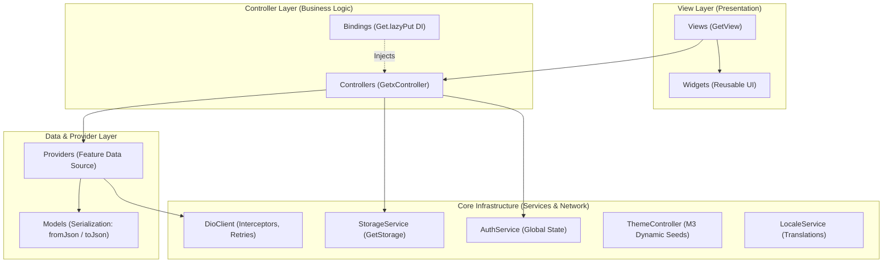

<div align="center">

# Flutter GetX MVC Boilerplate

**Modular GetX (MVC+S) Starter Project** — A production-ready, modular boilerplate for modern Flutter applications built with GetX.

[-02569B?style=for-the-badge&logo=flutter&logoColor=white)](https://flutter.dev)
[](https://dart.dev)
[](https://pub.dev/packages/get)
[](https://github.com/SheikhAman/flutter-getx-mvc-boilerplate)
[](LICENSE)

*A clean, scalable enterprise template featuring centralized network handling, reactive state management, dynamic theming, and modular slicing.*

[Features](#-features) · [Architecture](#-architecture-overview) · [Project Structure](#-project-structure) · [Quick Start](#-quick-start) · [Auth & Demo OTP](#-auth--demo-otp) · [Adding a Module](#-how-to-add-a-new-module) · [Testing](#-testing--quality-gates) · [Contributing](#-contributing) · [License](#-license)

</div>

---

> [!NOTE]
> **Architecture Clarification**: This project is built strictly following the **Modular GetX (MVC+S: Model-View-Controller-Service)** architecture pattern popularized by the Flutter GetX ecosystem. It is **NOT** an Uncle Bob Clean Architecture codebase (it contains no abstract domain entities, use-cases, or repository inversion interfaces). It emphasizes rapid, robust development with high cohesion, reactive controllers, and minimal boilerplate.

---

## 🚀 Features

Verified features implemented directly in this codebase:

* **Modular GetX State Management:** Clean separation into Modules (`bindings`, `controllers`, `providers`, `views`).
* **Authentication Flow (Mock):** Login, registration, forgot password, and 6-digit OTP verification (**Demo OTP: `112345`**).
* **Home Feed with Pagination:** REST integration with [JSONPlaceholder](https://jsonplaceholder.typicode.com) featuring page-based pagination, infinite scroll listener, and pull-to-refresh.
* **Post Details:** Dedicated detail view displaying post payload and user interactions.
* **Debounced Search:** Real-time search query execution with an automated 400ms debounce worker (`debounce(searchQuery, ...)`).
* **User Profile & State:** User metadata inspection, profile update simulation, and session management.
* **Dynamic Material 3 Theming:** Dark/light mode switching paired with **6 distinct primary color seeds** persisted locally via `GetStorage`.
* **Localization (i18n):** Instant runtime switching between **English (`en_US`)** and **Bengali (`bn_BD`)**.
* **Robust Networking (Dio):** Singleton `DioClient` with automated retries (timeouts & connection errors), JWT bearer token interceptor, centralized logging, and `ApiException` translation.
* **Showcase Hub:** Interactive catalog displaying custom design system components, typography tokens, dialogs, bottom sheets, and loaders.
* **Fallback & Recovery Screens:** Dedicated `NoInternetView`, `UnknownRouteView` (404 safety net), and `WebViewScreen`.

---

## 🏛 Architecture Overview

The codebase is organized according to the **Modular GetX MVC+S** design pattern:



### Architectural Principles Enforced:
1. **Views (`GetView<T>`):** Pure UI widgets that listen to reactive controller variables (`Obx`). Views never perform direct network requests or cache management.
2. **Controllers (`GetxController`):** Manage feature state, hold reactive primitives (`RxBool`, `RxList`, `RxString`), and delegate network I/O to dedicated Providers.
3. **Providers:** Encapsulate HTTP requests for their corresponding module using the centralized `DioClient`.
4. **Permanent Services (`GetxService`):** Singleton core services (`AuthService`, `StorageService`, `ThemeController`, `LocaleService`, `NetworkInfo`) initialized at bootstrap and maintained in memory.
5. **Dependency Injection (`Bindings`):** Routes load their required controllers and providers lazily upon navigation using `Get.lazyPut()`.

---

## 📂 Project Structure

```text
lib/
├── app/
│   ├── core/
│   │   ├── network/           # ApiConstants, ApiExceptions, ApiInterceptor, DioClient, NetworkInfo
│   │   ├── routes/            # AppPages, AppRoutes, Guards (AuthGuard, OnboardingGuard)
│   │   ├── services/          # AuthService, LocaleService, StorageService, ThemeController
│   │   ├── utils/             # AppSnackbar, Formatters, Validators
│   │   ├── values/            # AppAssets, AppColors, AppSizes, AppStrings, AppTextStyles
│   │   └── widgets/           # CustomAppBar, CustomButton, CustomTextField, EmptyStateView, LoadingView, ResponsiveLayout
│   ├── data/
│   │   └── models/            # ApiResponseModel, PostModel, UserModel
│   └── modules/
│       ├── auth/              # Bindings, Controllers, Providers, Views (Login, Register, OTP, ForgotPassword)
│       ├── common/            # NoInternetView, UnknownRouteView, WebViewView
│       ├── dashboard/         # DashboardView (Bottom Nav: Home, Search, Showcase, Profile)
│       ├── home/              # HomeView, PostCard widget, Pagination controller, HomeProvider
│       ├── onboarding/        # OnboardingView & OnboardingPageItem widget
│       ├── post_detail/       # PostDetailView, Controller, Provider
│       ├── profile/           # ProfileView, ProfileController, ProfileProvider
│       ├── search/            # SearchView, SearchController, SearchProvider
│       ├── settings/          # SettingsView, SettingsController (Theme, Palette Seeds, Locale)
│       ├── showcase/          # ShowcaseView, ShowcaseController, SectionHeader widget
│       └── splash/            # SplashView, SplashController (Navigation logic)
└── main.dart                  # ScreenUtilInit + EasyLoading + GetMaterialApp entrypoint
```

---

## 🛠 Tech Stack & Dependencies

Verified dependency versions configured in `pubspec.yaml`:

| Package | Version | Purpose |
| :--- | :--- | :--- |
| **Flutter SDK** | `>=3.3.0 <4.0.0` (Tested on `3.41.9`) | Framework runtime |
| **Dart SDK** | `3.11.5` | Programming language |
| **[get](https://pub.dev/packages/get)** | `^4.7.3` | State management, routing, and dependency injection |
| **[dio](https://pub.dev/packages/dio)** | `^5.9.2` | Advanced HTTP client with interceptors |
| **[get_storage](https://pub.dev/packages/get_storage)** | `^2.1.1` | Fast, persistent key-value storage |
| **[flutter_screenutil](https://pub.dev/packages/flutter_screenutil)** | `^5.9.3` | Responsive UI adapting to any screen dimensions |
| **[flutter_easyloading](https://pub.dev/packages/flutter_easyloading)** | `^3.0.5` | Global loading overlay indicator |
| **[connectivity_plus](https://pub.dev/packages/connectivity_plus)** | `^7.1.1` | Network status monitoring |
| **[pin_code_fields](https://pub.dev/packages/pin_code_fields)** | `^8.0.1` | 6-digit OTP pin input field |
| **[intl](https://pub.dev/packages/intl)** | `^0.20.2` | Date formatting and i18n support |
| **[shimmer](https://pub.dev/packages/shimmer)** | `^3.0.0` | Skeleton loading effects |
| **[webview_flutter](https://pub.dev/packages/webview_flutter)** | `^4.13.0` | In-app browser views |

---

## ⚡ Quick Start

### Prerequisites
- **Flutter SDK:** `3.41.9` (stable channel recommended)
- **Dart SDK:** `3.11.5`

### Installation & Run

```bash
# 1. Clone the repository
git clone https://github.com/SheikhAman/flutter-getx-mvc-boilerplate.git
cd flutter-getx-mvc-boilerplate

# 2. Install dependencies
flutter pub get

# 3. Verify static analysis and formatting
dart format --output=none --set-exit-if-changed .
flutter analyze

# 4. Run automated tests
flutter test

# 5. Launch the application
flutter run
```

---

## 🔐 Auth & Demo OTP

> [!IMPORTANT]
> The authentication module in this boilerplate is a **self-contained mock implementation** designed to demonstrate UI flows, form validation, and session storage without requiring a private backend server.

1. Launch the app and proceed through the **Onboarding** screen.
2. At the **Login** screen, enter any valid email format and password, or tap **Create Account** to view registration.
3. On form submission, you will be navigated to the **OTP Verification** screen.
4. Enter the public demo OTP code:
   $$\mathbf{112345}$$
   *(A 30-second resend countdown timer is active on this screen).*
5. Upon verification, the `UserModel` and demo token are saved into `StorageService`, transitioning the user directly into the **Dashboard**.

---

## 🧩 How to Add a New Module

Adding a new module follows the consistent 4-step GetX pattern:

### 1. Create the Provider
Create `lib/app/modules/<feature>/providers/<feature>_provider.dart`:
```dart
import '../../../core/network/dio_client.dart';

class FeatureProvider {
  final DioClient _dioClient;
  FeatureProvider({DioClient? dioClient}) : _dioClient = dioClient ?? DioClient();

  Future<dynamic> fetchData() async {
    return await _dioClient.get('/your-endpoint');
  }
}
```

### 2. Create the Controller
Create `lib/app/modules/<feature>/controllers/<feature>_controller.dart`:
```dart
import 'package:get/get.dart';
import '../providers/feature_provider.dart';

class FeatureController extends GetxController {
  final FeatureProvider provider;
  FeatureController({FeatureProvider? featureProvider})
      : provider = featureProvider ?? FeatureProvider();

  final RxBool isLoading = false.obs;
}
```

### 3. Create the Binding
Create `lib/app/modules/<feature>/bindings/<feature>_binding.dart`:
```dart
import 'package:get/get.dart';
import '../controllers/feature_controller.dart';
import '../providers/feature_provider.dart';

class FeatureBinding extends Bindings {
  @override
  void dependencies() {
    Get.lazyPut<FeatureProvider>(() => FeatureProvider());
    Get.lazyPut<FeatureController>(() => FeatureController(featureProvider: Get.find()));
  }
}
```

### 4. Create the View & Register Route
Create `lib/app/modules/<feature>/views/<feature>_view.dart`:
```dart
import 'package:flutter/material.dart';
import 'package:get/get.dart';
import '../controllers/feature_controller.dart';

class FeatureView extends GetView<FeatureController> {
  const FeatureView({super.key});

  @override
  Widget build(BuildContext context) {
    return Scaffold(
      appBar: AppBar(title: const Text('New Feature')),
      body: Center(child: Text('Feature Content')),
    );
  }
}
```
Finally, register the route in `lib/app/core/routes/app_routes.dart` and `lib/app/core/routes/app_pages.dart`.

---

## 🧪 Testing & Quality Gates

This repository enforces automated quality gates via GitHub Actions on every commit (`.github/workflows/ci.yml`):

* **Code Formatting:** `dart format --output=none --set-exit-if-changed .`
* **Static Analysis:** `flutter analyze` (Zero errors, zero warnings enforced)
* **Automated Test Suite:** 31 automated tests passing with **30.67%** full codebase line coverage (645 / 2,103 lines hit measured across the entire application via `flutter test --coverage`).

### Test Suite Structure
| Test Suite | File | Tests | Focus Area |
| :--- | :--- | :---: | :--- |
| **Core Primitives** | `test/widget_test.dart` | 5 | Validators, formatters, API constants, UserModel & PostModel serialization |
| **Home Controller** | `test/unit/controllers/home_controller_test.dart` | 4 | Initial fetch, pull-to-refresh, error states, and pagination |
| **Search Controller** | `test/unit/controllers/search_controller_test.dart` | 4 | Debounced 400ms search worker, state clearing, query reactivity |
| **Auth Controller** | `test/unit/controllers/auth_controller_test.dart` | 7 | Mock login, registration, OTP validation, timer management, reset flow |
| **Custom Button** | `test/widget/custom_button_test.dart` | 4 | Label rendering, tap callback, loading spinner, and icon |
| **Custom Text Field** | `test/widget/custom_text_field_test.dart` | 4 | Text entry, label/hint, password eye toggle, and prefix icon |
| **Post Card** | `test/widget/post_card_test.dart` | 2 | Layout rendering, author badge, metrics, and route navigation |
| **Splash & Bootstrap** | `test/widget/splash_transition_test.dart` | 1 | Full application boot, zero white screens, Splash to Onboarding transition |

To run the complete test suite locally:
```bash
flutter test
```

To run with coverage generation:
```bash
flutter test --coverage
```

---

## 🤝 Contributing

Contributions are welcome! Please review our [Contributing Guidelines](CONTRIBUTING.md) for details on code formatting, branching strategy, and pull request conventions.

---

## 📄 License

This project is open-source and distributed under the [MIT License](LICENSE).
Copyright (c) 2026 Sheikh Aman.
